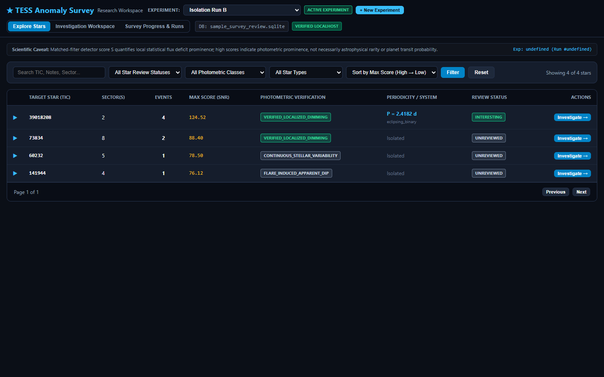
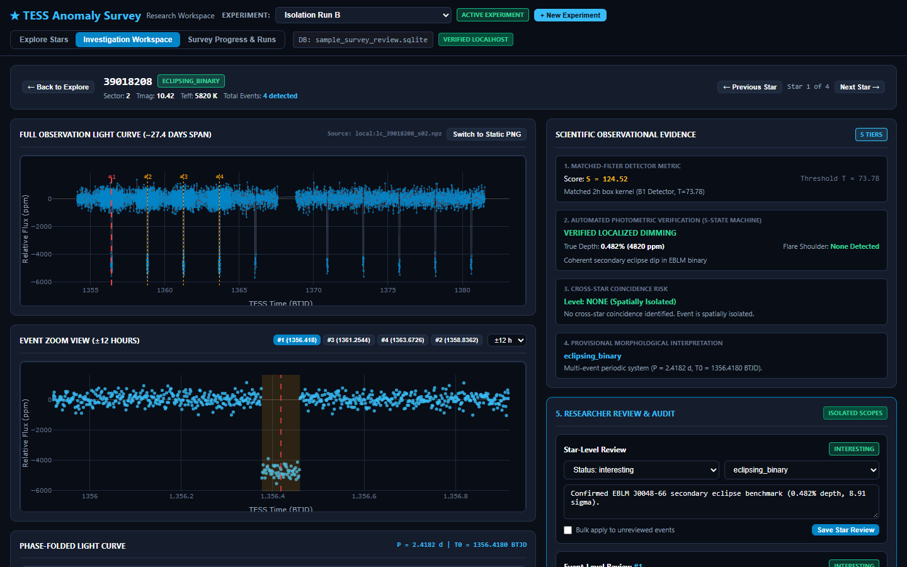
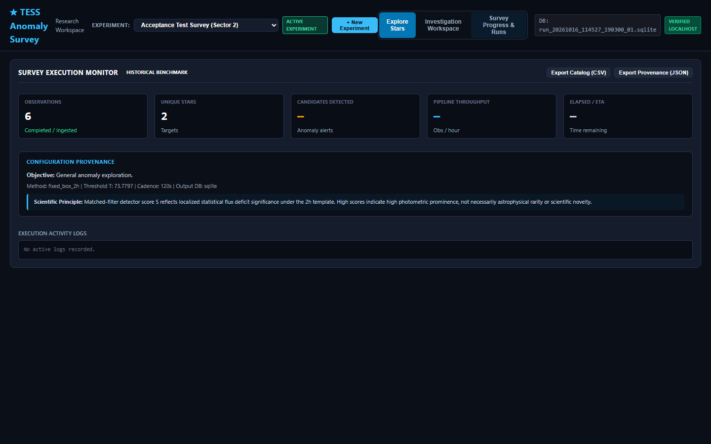
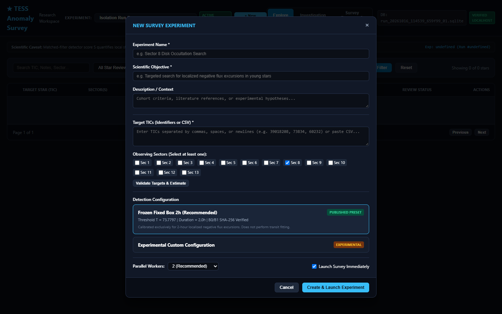

# TESS Anomaly Survey (`v0.3.0-beta`)

[](https://www.python.org/downloads/)
[](LICENSE)
[](RELEASE_NOTES.md)

A star-centered research workspace and streaming pipeline for detecting localized photometric anomalies in NASA Transiting Exoplanet Survey Satellite (TESS) light curves.

TESS Anomaly Survey provides an interactive web workspace, automated streaming ingestion from NASA's Barbara A. Mikulski Archive for Space Telescopes (MAST), non-destructive review overlays, and frozen, calibrated anomaly-detection algorithms designed for reproducible time-domain astronomy.

---

## Workspace Overview

The application transforms candidate triage from an uncontextualized alert stream into a structured, star-centered investigation workflow.

### Star-Centered Explore Catalog
Inspect aggregated target stars with anomaly metrics, event counts, minimum transit depths, and review statuses in a single view. Expand any star to view all detected event windows.



### Interactive Light-Curve Investigation
Analyze observations with synchronized full-sector overview plots, localized event-zoom light curves, and interactive phase folding (powered by automated Lomb-Scargle periodograms or custom periods).



### Streaming Survey Execution & Real-Time Telemetry
Launch streaming surveys directly against NASA MAST or local FITS archives. Monitor real-time cadence throughput, memory utilization, and anomaly yield via asynchronous HTTP polling.



---

## 5-Minute Quick Start

Get up and running with the bundled demo dataset in under 5 minutes without downloading external FITS files.

### 1. Installation

Clone the repository and install in a clean Python virtual environment (Python 3.10+):

#### Windows (PowerShell)
```powershell
git clone https://github.com/zgrap/TESS_Anomaly_Survey.git
cd TESS_Anomaly_Survey
python -m venv .venv
.\.venv\Scripts\Activate.ps1
python -m pip install --upgrade pip
python -m pip install -e ".[test]"
```

#### Linux & macOS (Bash / Zsh)
```bash
git clone https://github.com/zgrap/TESS_Anomaly_Survey.git
cd TESS_Anomaly_Survey
python3 -m venv .venv
source .venv/bin/activate
pip install --upgrade pip
pip install -e ".[test]"
```

### 2. Launch the Research Workspace

Launch the local web workspace using the bundled public sample dataset:

```bash
tess-anomaly review-ui --db examples/sample_survey_review.sqlite --root examples/sample_data --port 8000
```

Open your browser to:
```
http://127.0.0.1:8000
```

### 3. Interactive Triage Walkthrough
1. **Explore Stars**: Browse the bundled target stars. Filter by review status or search for target `TIC 39018208`.
2. **Expand Events**: Click on `TIC 39018208` to expand its detected candidate events.
3. **Inspect Light Curves**: Click **Inspect** to load the multi-panel light curve. Use mouse drag/scroll to pan and zoom on the localized event.
4. **Phase Folding**: Toggle **Folded Light Curve** to test automated Lomb-Scargle period finding or enter a trial period manually.
5. **Classify Candidate**: Select an astrophysical classification (e.g., `interesting`, `stellar_variability`, `instrumental_artifact`), add notes, and save. Notes and tags are stored non-destructively in `examples/sample_survey_review.reviews.sqlite`, leaving the primary survey database completely untouched.

---

## Streaming Surveys & NASA MAST Ingestion

TESS Anomaly Survey streams calibrated 2-minute SPOC light curves directly from NASA MAST.

### Launching via the Web Workspace
Click **New Experiment** in the top navigation bar to configure:
- Experiment name and output paths
- Target selection (comma-separated TICs or uploaded target CSV)
- Detection thresholds and cadence limits
- Optional live worker threads and cache retention



### Launching via Command-Line Interface
Alternatively, run surveys headless via the CLI:

```bash
# Create a target manifest (CSV with columns: tic_id, sector)
cat << 'EOF' > targets.csv
tic_id,sector
39018208,1
238194924,1
EOF

# Stream and scan directly from NASA MAST
tess-anomaly stream \
    --manifest targets.csv \
    --db my_survey.sqlite \
    --workers 2 \
    --allow-any-target
```

*Note on `--allow-any-target`:* This flag enables scanning arbitrary astronomical targets outside the pre-registered development cohort.

Interrupted surveys can be safely resumed at any time. Resumption tracks `(tic, sector, product_filename)` tuples to ensure distinct data products (such as 20s fast cadence vs 120s standard cadence) are never skipped.

---

## Scientific Methodology & Frozen Detector Standards

This software implements the detection methodology and empirical calibration framework developed for systematic localized anomaly searches in TESS photometry:

1. **Cadence & Windowing**:
   - The streaming pipeline is calibrated for NASA TESS SPOC 2-minute (120-second) cadence light curves from MAST.
   - Observations are sliced into contiguous 512-cadence (~17-day) sliding analysis windows with a 256-cadence (~8.5-day) stride, preserving native quality masks and data gaps without interpolation.
2. **Frozen Benchmark Detectors**:
   - `fixed_box_2h`: Fixed 2-hour localized box filter ($T = 73.77965536097444$ empirical cutoff calibrated on quiet stars; standard recommended default).
   - `multiscale_box`: Multiscale box filtering evaluating durations of 0.5h, 1.0h, 2.0h, 4.0h, and 8.0h.
   - `planet_template`: Physical transit template modeling (requires `batman-package`).
   - Baseline algorithms are byte-frozen and verified against original SHA-256 hashes (`ORIGINAL_B0_SHA256`, `ORIGINAL_B1_SHA256`).
3. **Empirical Calibration & Validation**:
   - Target alert rates (e.g., 0.05, 0.01, 0.005, 0.001) are fit to empirical noise quantiles on distinct calibration stars and validated on held-out star-disjoint cohorts.
   - Overlapping survey windows are correlated; a 1% window alert rate does not equal a 1% catalog false-alarm rate.
4. **Synthetic Demo Data Disclosure**:
   - The light curves in `examples/sample_data/` and candidate entries in `examples/sample_survey_review.sqlite` are synthetic demonstrations generated to verify software pipelines, user interface rendering, and review interactions. They do not represent real exoplanet discoveries.
5. **Astrophysical Limitations & Caveats**:
   - **An anomaly score is not an astrophysical discovery.** High-scoring events routinely arise from stellar flares, eclipsing binaries, rotational modulation, background contaminants, scattered Earth/Moon light, spacecraft momentum dumps, and data reduction systematics.
   - Physical interpretation requires multi-sector consistency checks, centroid motion analysis, pixel-level vetting, and independent spectroscopic follow-up.

---

## Security & Architectural Design

- **Localhost Binding Only**: By default, `review-ui` strictly binds to `127.0.0.1`.
- **Anti-DNS Rebinding**: Incoming HTTP requests validate the `Host` header, rejecting unauthorized proxy or external DNS rebinding attempts.
- **Anti-CSRF & Origin Verification**: Mutating `POST` endpoints enforce origin validation, preventing unauthorized cross-origin requests from browser tabs.
- **Immutable Research Records**: Review annotations, tags, and triage notes are persisted in separate `<database_name>.reviews.sqlite` sidecars. The original survey and validation databases remain read-only and bit-identical.
- **Terminal Portability**: Console logging uses strict ASCII formatting to prevent `UnicodeEncodeError` crashes on Windows Command Prompt / PowerShell environments.

---

## Troubleshooting & FAQ

### Port Already in Use
If port 8000 is occupied by another local service:
```bash
tess-anomaly review-ui --db examples/sample_survey_review.sqlite --root examples/sample_data --port 8080
```

### Missing C Compiler / Binary Wheels
All core dependencies (`numpy`, `scipy`, `astropy`, `astroquery`, `requests`, `psutil`) provide precompiled wheels on PyPI for Windows, Linux, and macOS. Ensure `pip` is updated:
```bash
python -m pip install --upgrade pip setuptools wheel
```

### NASA MAST Rate Limits
When running large-scale streaming surveys, network connection throttling or transient MAST downtime can occur. The streaming engine includes exponential backoff retry mechanisms. For large surveys (>1,000 stars), running with `--workers 2` or `--workers 4` provides an optimal balance of throughput and connection reliability.

---

## Citation

If you use TESS Anomaly Survey in your research, please cite the software release:

```bibtex
@software{graper2026tess,
  author       = {Zane A. Graper},
  title        = {TESS Anomaly Survey: Star-Centered Research Workspace and Calibrated Anomaly Detection},
  version      = {0.3.0-beta},
  year         = {2026},
  url          = {https://github.com/zgrap/TESS_Anomaly_Survey},
  note         = {Software release candidate; methodology manuscript in author review}
}
```

A companion methodology manuscript (*Systematic Localized Anomaly Detection in TESS Photometry: Methodology and Independent Sector-Level Validation*) is in author review; an updated preprint citation will be added once an arXiv identifier is assigned.

See [`CITATION.cff`](CITATION.cff) for complete machine-readable citation metadata.

---

## License

This project is licensed under the [MIT License](LICENSE).  
Copyright (c) 2026 Zane A. Graper.
